# Character Manager — TP3 (Java Visual SIH-6406)
Proyek ini adalah fondasi model class untuk aplikasi Character Manager berbasis Java 17. Berisi enum CharacterType dan class Character dengan dua constructor, validasi pada setter, serta fitur tambahan mana dan isAlive(). Class ini akan menjadi dasar GUI pada sprint berikutnya.

## Output Terminal
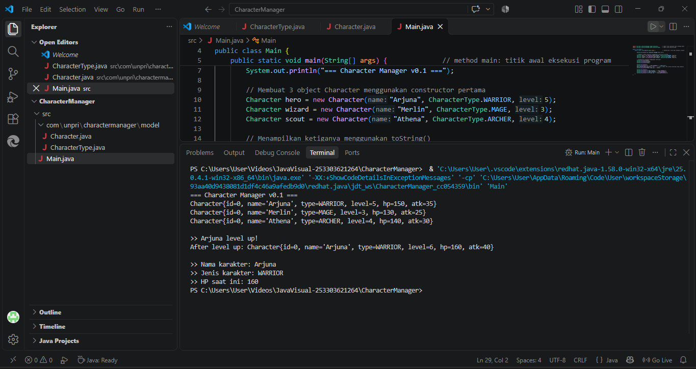

## Struktur Folder
```text
CharacterManager/
│
├── src/
│   ├── com/
│   │   └── unpri/
│   │       └── charactermanager/
│   │           └── model/
│   │               ├── Character.java
│   │               └── CharacterType.java
│   │
│   └── Main.java
│
├── output.png
└── README.md
```

## Identitas
Nama: Melinda Sabella Br Sebayang
NIM: 253303621264

Analisis Bagian D (Google Docs): https://drive.google.com/file/d/10qqMgpQweH1hguRy-HufImM3rK4KVOAw/view?usp=drivesdk


# TP5 — Character Manager Sprint #2
Pada sprint ini ditambahkan class CharacterManager yang mengelola koleksi Character memakai ArrayList, dengan penolakan nama duplikat lewat equals(), getAllCharacters() yang mengembalikan salinan (defensive copy), serta counter static untuk jumlah objek yang dibuat.

## Fitur baru
equals() pada Character membandingkan nama, sehingga nama duplikat ditolak
totalCharacterCreated (static) menghitung jumlah objek Character yang dibuat
CharacterManager: addCharacter(), findByName(), removeCharacter(), getTotalCharacters(), getAllCharacters()
Mini-Challenge: getAverageLevel() (mengembalikan 0 jika list kosong) dan findByType()
Fitur mandiri: getTypeSummary()

## Screenshot output (CRUD dan eksperimen reference)
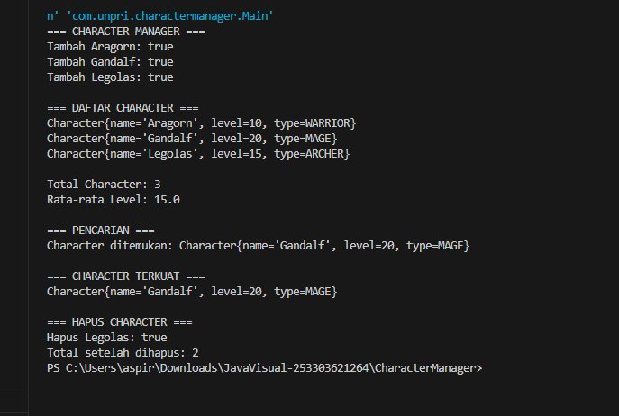

Screenshot memperlihatkan nama duplikat ditolak, getAverageLevel() pada list kosong menghasilkan 0.0 tanpa error, serta eksperimen reference: asli == duplikatReferensi bernilai true, sedangkan menambah karakter ke salinan list tidak mengubah total di manager (manager tetap 2, salinan menjadi 3).

Fitur mandiri (Bagian C): getTypeSummary()
getTypeSummary() merangkum jumlah karakter untuk setiap tipe (WARRIOR, MAGE, ARCHER, HEALER) dalam satu String, misalnya untuk ditampilkan di GUI pada sprint berikutnya. Method ini mengembalikan String, bukan characterList atau salinannya, karena String tidak dapat diubah dari luar. Pemanggil hanya menerima hasil hitungan dan tidak pernah memegang reference ke list internal, sehingga Encapsulation terjaga dan perubahan data hanya bisa lewat addCharacter() dan removeCharacter(). Method memakai CharacterType.values(), sehingga jika kelak ditambah tipe baru seperti NECROMANCER, method ini otomatis ikut menghitungnya tanpa perlu diubah.

## Struktur Folder Proyek (Sprint 2 - AP5 / TP5)
```text
CharacterManager/
│
├── src/
│   ├── com/
│   │   └── unpri/
│   │       └── charactermanager/
│   │           └── model/
│   │               ├── Character.java
│   │               ├── CharacterManager.java
│   │               └── CharacterType.java
│   │
│   └── Main.java
│
├── output-tp5.png
├── output.png
└── README.md
```

## Analisis Bagian D TP5 (Google Docs):
 https://drive.google.com/file/d/1rvQJx1r6zLfGoKp5hv5eG4tY80WtmCHJ/view?usp=drivesdk


 # TP8 — Character Manager Sprint #3
Pada sprint ini aplikasi berpindah dari console ke GUI. Ditambahkan class MainWindow (package view, extends JFrame) yang menampilkan daftar karakter secara dinamis lewat loop, ditambah statistik "Rata-rata Level" di bawah daftar. Main.java menjalankan jendela lewat SwingUtilities.invokeLater().

## Screenshot MainWindow
Sebelum data diubah (Gandalf level 7, rata-rata level 4.20):

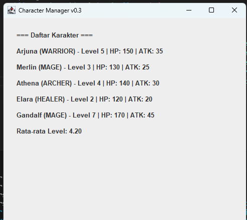

Sesudah data diubah (Gandalf level 10, rata-rata level 4.80):

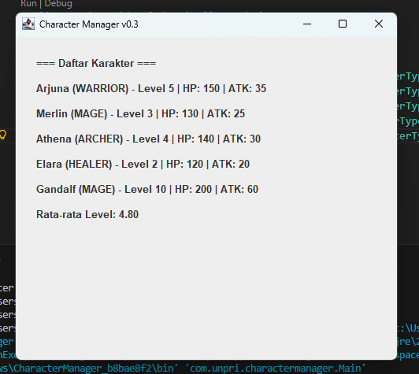

Kedua screenshot memuat 5 karakter dan membuktikan bahwa statistik ikut berubah saat data diubah.

## Aliran data: Main → CharacterManager → MainWindow
Main.java membuat CharacterManager dan mengisinya dengan lima karakter (Model). Data diambil lewat manager.getAllCharacters(), yang mengembalikan salinan list, lalu diteruskan ke constructor MainWindow. MainWindow (View) hanya menerima list itu, membuat satu JLabel untuk setiap karakter lewat loop, dan menampilkan rata-rata level, tanpa mengetahui cara data disimpan. Dalam MVC, Main untuk sementara berperan sebagai penghubung (pengganti Controller yang dibangun pada pertemuan berikutnya): Model tidak mengenal View, dan View tidak mengubah data Model.

## Karakter baru
Karakter	Tipe	Level	Alasan pemilihan
Elara	HEALER	2	Melengkapi empat tipe karakter (sebelumnya belum ada HEALER) dan level rendah agar datanya bervariasi
Gandalf	MAGE	7, lalu diubah menjadi 10	Level tinggi sehingga pengaruhnya pada rata-rata level terlihat jelas saat data diubah


## Struktur folder
```text
CharacterManager/
│
├── src/
│   └── com/
│       └── unpri/
│           └── charactermanager/
│               ├── model/
│               │   ├── Character.java
│               │   ├── CharacterManager.java
│               │   └── CharacterType.java
│               │
│               ├── view/
│               │   └── MainWindow.java
│               │
│               └── Main.java
│
├── output-tp5.png
├── output.png
├── tp8-sebelum.png
├── tp8-sesudah.png
└── README.md
```


## Analisis Bagian D TP8 (Google Docs) :
https://drive.google.com/file/d/1Z3uJUBnxQcs_jQHz9VDmKY6ihC2xiDnz/view?usp=drivesdk


# TP10 — Character Manager Sprint #4
Pada sprint ini MainWindow naik dari v0.3 ke v0.4. Ditambahkan class AppTheme (package view) yang menjadi pusat warna, font, dan border, sehingga daftar karakter tampil sebagai kartu berwarna menurut role. Package model tidak berubah sama sekali.

## Screenshot sebelum (v0.3) dan sesudah (v0.4)

Sebelum (v0.3):


Sesudah (v0.4):

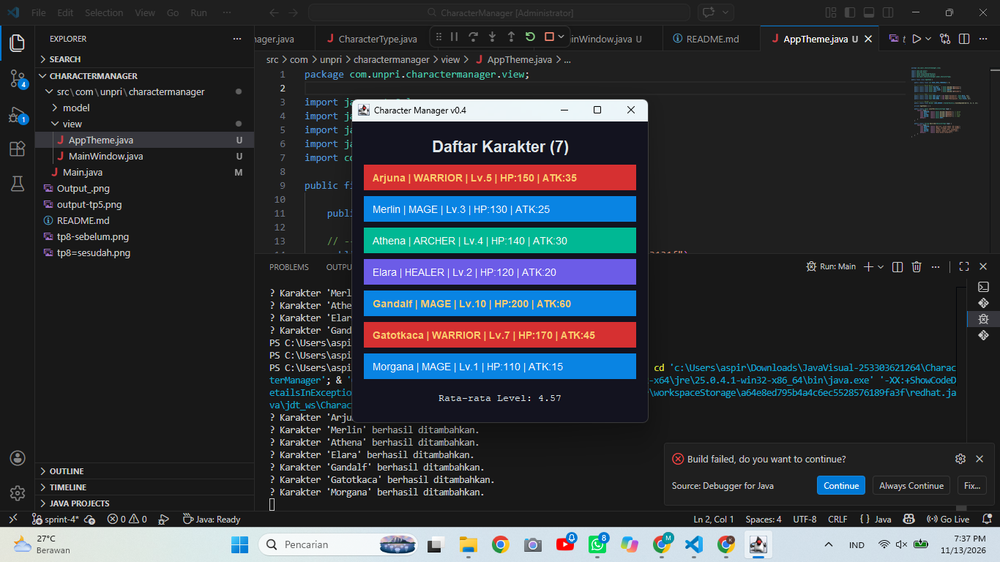

## Mengapa warna disimpan di AppTheme, bukan di Character
Warna adalah urusan tampilan, bukan data karakter, sehingga pemetaannya saya letakkan di AppTheme.colorFor(CharacterType) pada package view. Jika Character menyimpan java.awt.Color, class Model akan bergantung pada library GUI sehingga tidak bisa dipakai di aplikasi konsol atau unit test tanpa GUI, dan sulit dimigrasi ke JavaFX yang punya class Color sendiri. Dengan rancangan ini arah ketergantungan hanya satu arah (View mengenal Model lewat enum, Model tidak mengenal View), dan mengganti tema cukup dengan mengedit AppTheme.java. Bukti Model tidak berubah ada di bagian "Bukti git diff" di bawah.

## Mini-Challenge: highlight level tinggi
Karakter dengan level ≥ 5 tampil dengan teks emas dan tebal. Batasnya disimpan sebagai konstanta bernama HIGH_LEVEL_THRESHOLD = 5 di AppTheme, bukan angka tertulis di dalam if. Saya menaruhnya di View karena "level tinggi" di sini hanya aturan tampilan (kapan sebuah kartu disorot), bukan aturan permainan, dan Model memang tidak boleh diubah.

## Dua properti tambahan
Properti Komponen Tambahan
Properti	Penerapan	Alasan
Tooltip berisi detail HP/ATK	setToolTipText(describe(role) + " | HP .., ATK ..")	Detail statistik tersedia saat kursor diam di kartu tanpa membuat teks kartu terlalu panjang
setEnabled(false) untuk karakter level 1	Kartu Morgana tampil redup	Menandai karakter yang belum siap tanpa menyembunyikannya, sehingga pengguna tetap tahu karakternya ada
Batas level 1 juga disimpan sebagai konstanta bernama (DISABLED_LEVEL).

## Bukti git diff: package model tidak berubah
git diff HEAD~1 HEAD --stat -- src/com/unpri/charactermanager/model
Output perintah di atas kosong, artinya tidak ada perubahan di Character.java, CharacterType.java, maupun CharacterManager.java.

## Struktur folder
```text
CharacterManager/
├── src/
│   ├── com/
│   │   └── unpri/
│   │       └── charactermanager/
│   │           ├── model/
│   │           │   ├── Character.java
│   │           │   ├── CharacterManager.java
│   │           │   └── CharacterType.java
│   │           └── view/
│   │               ├── AppTheme.java
│   │               └── MainWindow.java
│   └── Main.java
├── README.md
├── output.png
├── output-tp5.png
├── tp8-sebelum.png
├── tp8-sesudah.png
├── tp10-sebelum-v03.png
└── tp10-sesudah-v04.png
```
## Analisis Bagian D TP10 (Google Docs) : 
https://drive.google.com/file/d/15pZIKHEtcbooPL1HmfDV0KP4A_FoDkTD/view?usp=drivesdk


# TP12 — Character Manager Sprint #5
Pada sprint ini MainWindow naik dari v0.4 ke v0.5 dengan tata letak BorderLayout yang tetap rapi saat jendela diubah ukurannya. Empat wilayah terisi: header dan panel statistik (NORTH), daftar karakter berscroll (CENTER), legenda role (EAST), dan bar status (SOUTH). Package model tidak berubah sama sekali.

## Wireframe
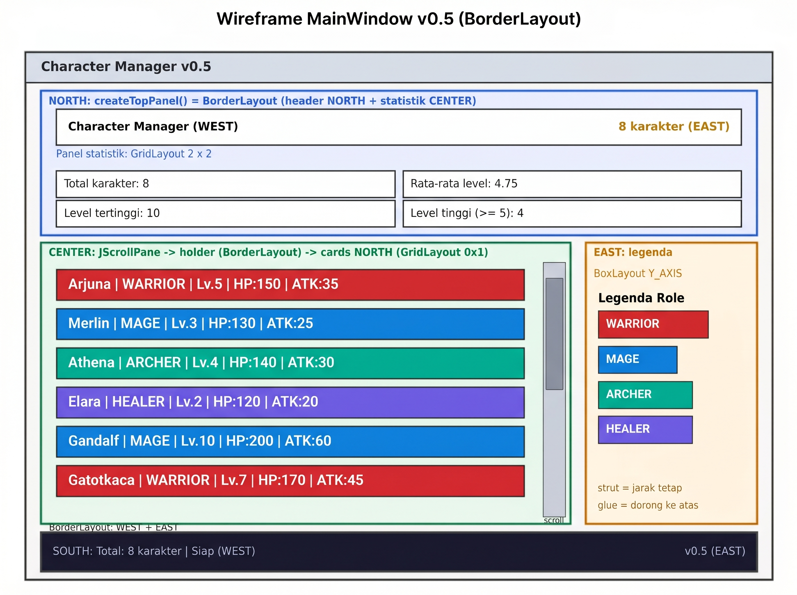

## Screenshot
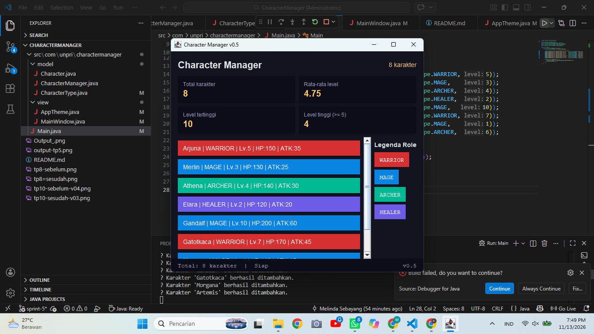

Jendela dilebarkan:

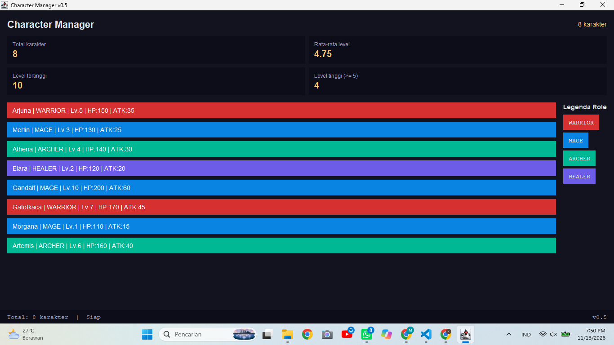

Jendela dikecilkan sampai scrollbar tampak:

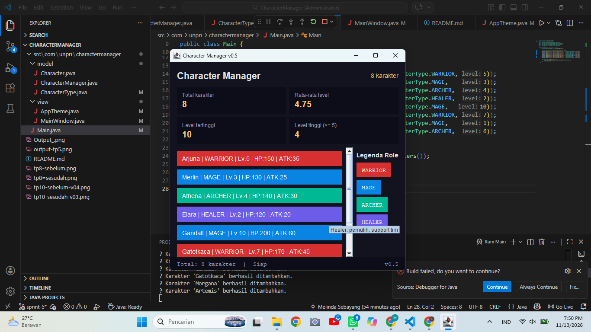

## Tabel pengamatan resize (prediksi vs hasil)

| Aksi | Prediksi (berdasarkan aturan BorderLayout) | Hasil pengamatan |
| :--- | :--- | :--- |
| **Jendela dilebarkan** | Hanya wilayah **CENTER** yang ikut melebar. Legenda (`EAST`) tetap selebar isinya, sedangkan header dan bar status memanjang mengikuti lebar jendela. | Jendela dapat ditarik melebar ke kanan dan ke kiri, serta dapat di-maximize. Daftar kartu di tengah ikut melebar mengisi ruang tambahan, sementara legenda tetap berukuran sama dan header serta bar status memanjang. Hasilnya sesuai prediksi. |
| **Jendela ditinggikan** | Wilayah **CENTER** bertambah tinggi. Kartu tidak melar karena grid kartu berada di **NORTH** panel `holder`, dan legenda tetap menempel di atas. | Jendela dapat ditarik ke atas dan ke bawah. Area daftar bertambah tinggi, kartu tetap pada tinggi alaminya dengan ruang kosong di bawahnya, dan legenda tetap di bagian atas. Hasilnya sesuai prediksi. |
| **Tinggi dikecilkan** | Scrollbar muncul atau bertambah panjang di area daftar, sedangkan header dan bar status tetap terlihat. | Ketika tinggi dikecilkan, daftar karakter dapat digeser naik-turun dengan scrollbar sehingga seluruh karakter tetap bisa dilihat, dan header serta bar status tetap tampil. Hasilnya sesuai prediksi. |
| **Disempitkan sampai batas** | Jendela berhenti mengecil pada ukuran $560 \times 380$ karena `setMinimumSize`. | Jendela berhenti mengecil pada ukuran minimum dan tidak bisa diperkecil lagi, sehingga tampilan tidak terpotong. Hasilnya sesuai prediksi. |

Kesimpulannya, tata letak BorderLayout bekerja sesuai rancangan: hanya CENTER yang menyerap perubahan ukuran, area lain mempertahankan ukurannya, dan JScrollPane menjaga seluruh karakter tetap dapat diakses ketika ruang tidak cukup.|

## Struktur panel bersarang

MainWindow memakai BorderLayout dengan empat wilayah, dan setiap wilayah berisi panel yang tersusun bersarang. NORTH berisi panel pembungkus top yang memuat header (judul di kiri, jumlah karakter di kanan) dan panel statistik GridLayout 2x2. CENTER berisi JScrollPane yang membungkus panel holder, dan di NORTH holder ada panel cards ber- GridLayout yang menampung kartu karakter. EAST berisi legenda BoxLayout vertikal yang diturunkan dari CharacterType.values(), dan SOUTH berisi bar status dengan teks di kiri dan versi di kanan.

```text
MainWindow (JFrame, BorderLayout)
├── NORTH  : top (JPanel, BorderLayout)
│   ├── NORTH  : header (BorderLayout)  judul WEST, jumlah EAST
│   └── CENTER : stats (GridLayout 2x2) empat sel statistik
├── CENTER : JScrollPane
│   └── holder (BorderLayout)
│       └── NORTH : cards (GridLayout 0x1) -> kartu JLabel
├── EAST   : legend (BoxLayout Y_AXIS) -> strut, chip per role, glue
└── SOUTH  : status (BorderLayout)  teks WEST, versi EAST
```

## Panel tambahan: statistik GridLayout 2x2
Panel statistik (total karakter, rata-rata level, level tertinggi, jumlah karakter level tinggi) saya taruh di bawah header. Saya memilih GridLayout 2x2 karena keempat statistik setara dan sebaiknya berukuran seragam, serta tetap tersusun dua kolom saat jendela dilebarkan. Layout yang saya tolak:

FlowLayout: sel berukuran sesuai isi (tidak seragam), dan bisa pindah baris sendiri ketika jendela menyempit sehingga susunan 2x2 tidak stabil.
BoxLayout: hanya menyusun pada satu sumbu, sehingga 2x2 membutuhkan panel bersarang tambahan.
GridBagLayout: terlalu rumit untuk empat sel yang ukurannya sama.
Bar status awalnya memakai FlowLayout, lalu saya ganti ke BorderLayout agar teks status menempel kiri dan versi menempel kanan, karena FlowLayout tidak bisa menempelkan elemen ke sisi kanan.

Catatan: statistik dihitung di MainWindow dari list yang diterima. Idealnya perhitungan seperti itu berada di Model atau Controller, dan ini saya catat sebagai perbaikan untuk sprint berikutnya.

## Bukti git diff: package model tidak berubah
```text
git diff HEAD~1 HEAD --stat -- src/com/unpri/charactermanager/model
```
Output perintah di atas kosong, artinya tidak ada perubahan di Character.java, CharacterType.java, maupun CharacterManager.java.

## Struktur folder
```text
CharacterManager/
├── src/
│   ├── com/
│   │   └── unpri/
│   │       └── charactermanager/
│   │           ├── model/
│   │           │   ├── Character.java
│   │           │   ├── CharacterManager.java
│   │           │   └── CharacterType.java
│   │           └── view/
│   │               ├── AppTheme.java
│   │               └── MainWindow.java
│   └── Main.java
├── output-tp5.png
├── output.png
├── README.MD
├── tp8-sebelum.png
├── tp8-sesudah.png
├── tp10-sebelum-v03.png
├── tp10-sesudah-v04.png
├── tp12-awal.png
├── tp12-kecil.png
├── tp12-lebar.png
└── tp12-wireframe.jpg
```

## Analisis Bagian D TP12 (Google Docs) : 
https://docs.google.com/document/d/1jQ9VMbjG2IinEtHFYRKBhpACaiA-Vn2-/edit?usp=drive_link&ouid=114747620289340159408&rtpof=true&sd=true


# Character Manager — TP14 (Java Visual SIH-6406)

Pada sprint ini (v0.5 ke v0.6), aplikasi Character Manager ditingkatkan dari sekadar penampil data menjadi alat kerja interaktif yang mampu menerima input karakter baru melalui CharacterFormPanel di wilayah WEST (JTextField, JComboBox, dan JSpinner). Perubahan juga dilakukan pada package model untuk menegakkan aturan bisnis di konstruktor Character serta pemeriksaan keunikan nama di CharacterManager, disertai validasi berlapis dan pembaruan daftar otomatis lewat refreshList().

# Screenshot

Error nama kosong (pesan inline merah, border merah, kursor kembali ke field nama):


Error nama sudah dipakai (deteksi duplikat case-insensitive):
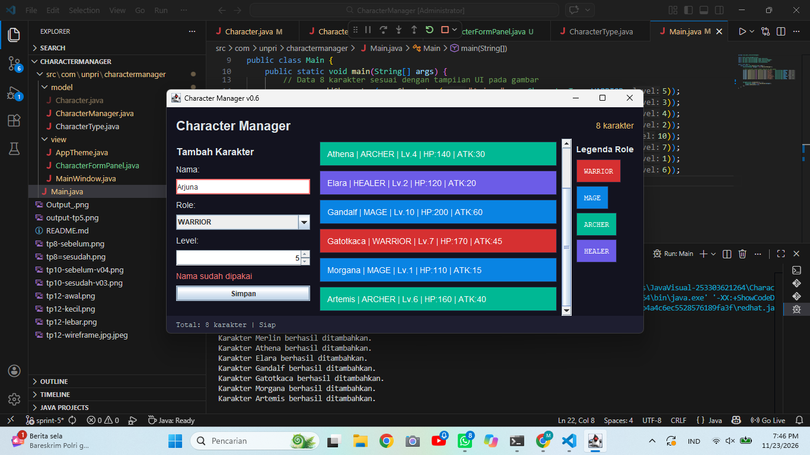

Input valid berhasil disimpan (kartu baru langsung muncul & pesan hijau):
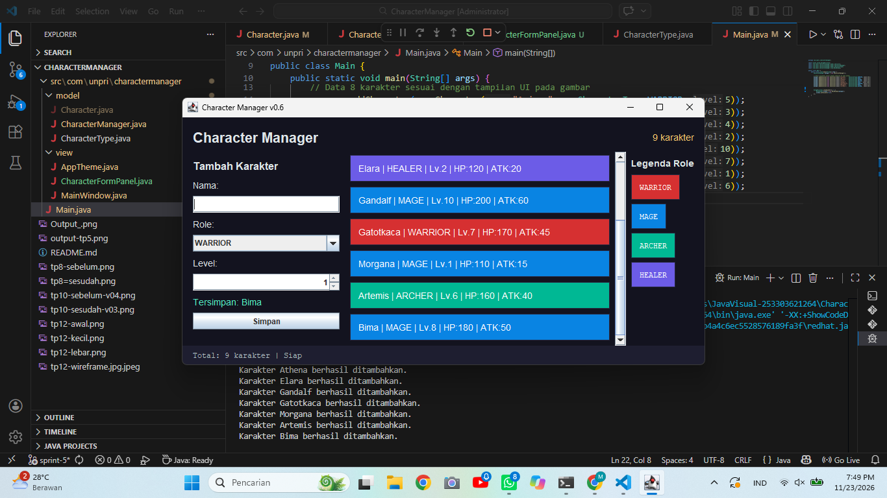

Bukti Mini-Challenge (aturan konsistensi MAGE maksimal level 60 dari Model):
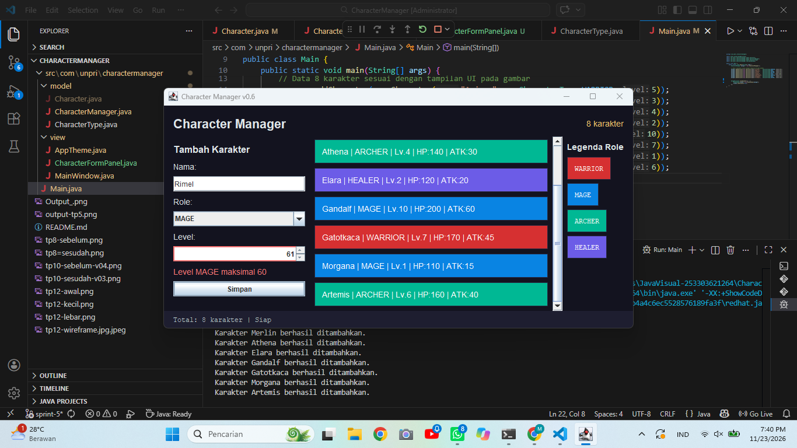

Bukti aturan baru (larangan spasi ganda di View):


### Tabel Uji (Matriks Input)

| No | Input | Hasil Diharapkan | Hasil Nyata | Lapisan yang Menangkap |
| :--- | :--- | :--- | :--- | :--- |
| 1 | Nama: `(kosong)` | Pesan `"Nama wajib diisi"`, border merah di field nama, kursor kembali ke field | Sesuai harapan; jumlah karakter tetap 8[cite: 6] | View (`validateName` — kelengkapan)[cite: 1] |
| 2 | Nama: `"   "` (hanya spasi) | Dianggap kosong setelah `trim()`, pesan `"Nama wajib diisi"` | Sesuai harapan; spasi tepi dibersihkan lalu ditolak[cite: 1] | View (`trim()` + `validateName`)[cite: 1] |
| 3 | Nama: `Ab` (2 huruf) | Pesan `"Nama harus 3-20 karakter"`, border merah | Sesuai harapan; ditolak sebelum masuk Model[cite: 1] | View (`validateName` — panjang)[cite: 1] |
| 4 | Nama: `Arjuna123` | Pesan `"Nama hanya huruf dan spasi"`, border merah | Sesuai harapan; angka ditolak oleh regex `[A-Za-z ]+`[cite: 1] | View (`validateName` — format)[cite: 1] |
| 5 | Nama: `arjuna` (huruf kecil) | Pesan `"Nama sudah dipakai"`, border merah | Sesuai harapan; terdeteksi sama dengan `"Arjuna"`[cite: 7] | Model (`CharacterManager.isNameTaken`)[cite: 1] |
| 6 | Nama: `Bima`, Role: `MAGE`, Level: `8` | Tersimpan; kartu baru muncul di daftar; pesan hijau `"Tersimpan: Bima"`; form di-reset | Sesuai harapan; total karakter naik menjadi 9[cite: 5] | Lolos semua lapisan (Sukses)[cite: 1] |
| 7 | Nama: 21 huruf (`Abcdefghijklmnopqrstu`) | Pesan `"Nama harus 3-20 karakter"`, border merah | Sesuai harapan; melebihi batas maksimal 20 karakter[cite: 1] | View (`validateName` — panjang)[cite: 1] |
| 8 | Nama: `"  Bima Sakti  "` | Tersimpan sebagai `"Bima Sakti"` tanpa spasi berlebih di awal/akhir | Sesuai harapan; spasi tepi dibuang oleh `trim()`[cite: 1] | View (`trim()`) $\rightarrow$ Model |
| 9 | Level: ketik `500` di `JSpinner` lalu Simpan | Tidak ada karakter level > 99 yang masuk ke daftar | Saat Simpan ditekan, `commitEdit()` otomatis mengembalikan nilai spinner ke batas maksimum `99` sehingga level 500 tidak pernah terkirim | View (`SpinnerNumberModel` + `commitEdit()`)[cite: 1] |
| 10 | Nama: `Aurora`, Role: `MAGE`, Level: `61` *(Mini-Challenge)* | Ditolak dengan pesan `"Level MAGE maksimal 60"` dan border merah pada level | Sesuai harapan; pesan dari Model tampil otomatis tanpa mengubah `CharacterFormPanel`[cite: 1, 4] | Model (Konstruktor `Character`)[cite: 1] |
| 11 | Nama: `Bima  Sakti` *(Aturan Baru 1 — spasi ganda)* | Pesan `"Nama tidak boleh mengandung spasi ganda"`, border merah pada nama | Pesan error tampil dan karakter ditolak, namun teks pada `messageLabel` terpotong menjadi `"Nama tidak boleh mengandung s..."` karena lebar panel kiri `250px`[cite: 8] | View (`validateName` — format) |
| 12 | Tambah karakter ke-16 saat daftar berisi 15 karakter *(Aturan Baru 2)* | Ditolak dengan pesan `"Daftar penuh (maksimal 15 karakter)"` | Sesuai harapan; penambahan dibatalkan dan pesan dari Model tampil di form | Model (`CharacterManager.addCharacter`) |

**Catatan Pengamatan & Tindakan Perbaikan:**
1. **Perilaku `JSpinner` pada input `500`:** `SpinnerNumberModel(1, 1, 99, 1)` menjaga rentang saat `commitEdit()` dipanggil sehingga angka di luar rentang otomatis dikembalikan ke nilai sah terakhir atau batas maksimum `99`[cite: 1]. Jika ada jalur lain di luar form yang mencoba membuat karakter level `500`, konstruktor `Character` tetap menolaknya dengan `IllegalArgumentException`[cite: 1].
2. **Teks error terpotong pada aturan spasi ganda:** Pada pengujian kasus ke-11, pesan `"Nama tidak boleh mengandung spasi ganda"` terpotong elipsis (`...`) karena lebar `CharacterFormPanel` ditetapkan `250px`[cite: 1, 8]. Tindakan perbaikannya adalah mempersingkat teks pesan menjadi `"Tidak boleh ada spasi ganda"` agar seluruh kalimat terbaca utuh di dalam panel.

---

### Dua Aturan Validasi Baru & Alasan Penempatannya

1. **Larangan Spasi Ganda pada Nama — Diletakkan di View (`CharacterFormPanel.validateName`)**
   * **Implementasi:** Menambahkan pemeriksaan `if (name.contains("  ")) return "Nama tidak boleh mengandung spasi ganda";` di dalam `validateName()`.
   * **Alasan:** Pengecekan spasi ganda merupakan aturan format penulisan masukan keyboard pengguna di antarmuka form (sejajar dengan validasi panjang dan karakter huruf/spasi), sehingga layak disaring langsung di lapisan **View** sebelum objek karakter dibuat[cite: 1].

2. **Batas Maksimal 15 Karakter dalam Daftar — Diletakkan di Model (`CharacterManager.addCharacter`)**
   * **Implementasi:** Menambahkan pemeriksaan `if (getTotalCharacters() >= 15) throw new IllegalArgumentException("Daftar penuh (maksimal 15 karakter)");` pada awal method `addCharacter()`.
   * **Alasan:** Kapasitas penyimpanan koleksi karakter adalah aturan bisnis (*domain rule*) milik `CharacterManager` yang tetap masuk akal meskipun aplikasi berjalan tanpa GUI[cite: 1]. Dengan meletakkannya di **Model**, aturan ini melindungi daftar dari sumber data mana pun dan pesannya otomatis ditangkap oleh `catch (IllegalArgumentException ex)` di form tanpa mengubah kode `CharacterFormPanel`[cite: 1].

---

### Kompromi Arsitektur Sementara

Pada Sprint #6 ini terdapat dua kompromi sementara yang sengaja dilakukan agar fokus tetap pada alur input dan validasi berlapis[cite: 1]. Pertama, tombol `Simpan` dan `nameField` menggunakan `addActionListener(e -> onSave())` secara langsung di dalam kelas View, bukan melalui kelas pengendali terpisah[cite: 1]. Kedua, `CharacterFormPanel` memanggil `manager.addCharacter()` secara langsung sehingga View masih berinteraksi langsung dengan Model[cite: 1]. Kedua kompromi ini akan dirapikan pada Pertemuan 9 dengan memindahkan penanganan event dan koordinasi pembaruan data ke lapisan **Controller**[cite: 1].

---

### Struktur Panel Bersarang (`MainWindow` v0.6)

`MainWindow` menggunakan `BorderLayout` dengan lima wilayah yang terisi penuh[cite: 1]:
* **NORTH:** `header` (`BorderLayout`) yang memuat judul aplikasi di `WEST` dan `countLabel` di `EAST`[cite: 1].
* **WEST:** `CharacterFormPanel` (`BorderLayout`) dengan lebar tetap `250px`, menampung panel `rows` (`GridLayout 0x1`) di posisi `NORTH` agar tinggi komponen input tetap alami dan tidak melar[cite: 1].
* **CENTER:** `JScrollPane` yang membungkus `holder` (`BorderLayout`), dengan `cardsPanel` (`GridLayout 0x1`) di posisi `NORTH` untuk menampung kartu karakter `JLabel` yang diperbarui lewat `refreshList()`[cite: 1].
* **EAST:** `legend` (`BoxLayout Y_AXIS`) yang menampilkan chip warna tiap `CharacterType`[cite: 1].
* **SOUTH:** `status` (`FlowLayout LEFT`) yang menampilkan `statusLabel` jumlah karakter aktif[cite: 1].

```text
MainWindow (JFrame, BorderLayout)
├── NORTH  : header (BorderLayout) -> judul (WEST), countLabel (EAST)
├── WEST   : CharacterFormPanel (BorderLayout, 250px)
│   └── NORTH : rows (GridLayout 0x1) -> title, nameField, roleBox, levelSpinner, messageLabel, saveButton
├── CENTER : JScrollPane
│   └── holder (BorderLayout)
│       └── NORTH : cardsPanel (GridLayout 0x1) -> kartu karakter (JLabel)
├── EAST   : legend (BoxLayout Y_AXIS) -> strut, chip per CharacterType, glue
└── SOUTH  : status (FlowLayout LEFT) -> statusLabel
```

## Struktur Folder
```text
CharacterManager/
├── src/
│   └── com/
│       └── unpri/
│           └── charactermanager/
│               ├── model/
│               │   ├── Character.java
│               │   ├── CharacterManager.java
│               │   └── CharacterType.java
│               ├── view/
│               │   ├── AppTheme.java
│               │   ├── CharacterFormPanel.java
│               │   └── MainWindow.java
│               └── Main.java
├── README.MD
├── output-tp5.png
├── output.png
├── tp8-sebelum.png
├── tp8-sesudah.png
├── tp10-sebelum-v03.png
├── tp10-sesudah-v04.png
├── tp12-awal.png
├── tp12-kecil.png
├── tp12-lebar.png
├── tp12-wireframe.png
├── tp14-error-duplikat.png
├── tp14-error-kosong.png
├── tp14-error-spasi-ganda.png
├── tp14-minichallenge.png
└── tp14-sukses.png
```

## Identitas & Analisis Bagian D
Nama : Melinda Sabella Br Sebayang

Nim : 253303621264

## Analisis Input & Validasi (Google Docs):
https://drive.google.com/file/d/1ehh6NbKuTOEipmfaK5upkwsbfVV9-k8s/view?usp=drivesdk